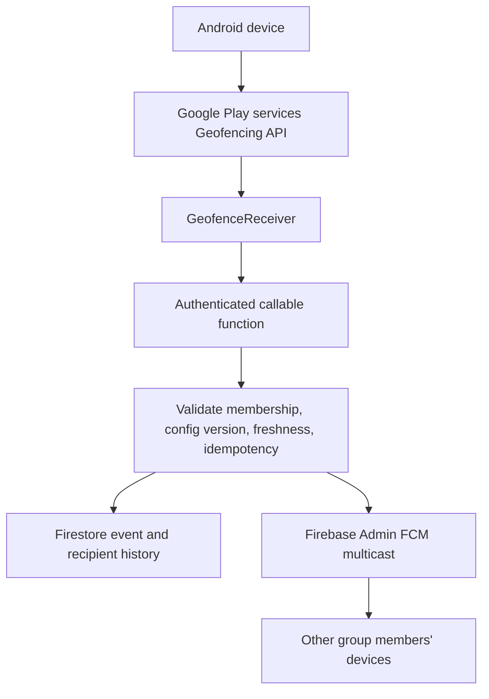

# GroupFence

Java/XML Android application for group geofence entry/exit alerts, using Firebase Authentication, Cloud Firestore, callable Cloud Functions, and Firebase Cloud Messaging.

## Architecture



## Project contents

- `app/`: Android app in Java and XML, min SDK 24, target SDK 35.
- `functions/`: trusted Firebase callable functions for group creation, invitation redemption, leaving groups, and event processing.
- `firestore.rules`: deny-by-default rules; privileged membership and event writes are backend-only.
- `firebase.json`: Firebase CLI configuration.

## Required setup

1. Install Android Studio with Android SDK 36 and JDK 17 (required by current Android Gradle Plugin; app source is Java 11 compatible).
2. Create a Firebase project at https://console.firebase.google.com/.
3. Add an Android app with package name `com.example.groupfence`.
4. Download `google-services.json` and place it in `app/google-services.json`. This file is intentionally not included.
5. In Firebase Authentication, enable Email/Password.
6. Create a Cloud Firestore database.
7. Upgrade the Firebase project to the Blaze plan if required by the currently selected Cloud Functions runtime and deployment features.
8. Install Firebase CLI (`npm install -g firebase-tools`), then run `firebase login` and `firebase use --add` from this project directory.
9. Deploy rules and functions:
   ```bash
   cd functions
   npm install
   cd ..
   firebase deploy --only firestore:rules,functions
   ```
10. Open the project in Android Studio, allow Gradle sync, and run on a device with Google Play services.

No Google Maps API key is required by this version. Geofence centre is configured with latitude/longitude fields. You can use a trusted map or coordinates picker later without changing the backend event schema.

## Important setup notes

- Do not commit `google-services.json` if your repository policy treats it as environment-specific; never commit service-account private keys.
- Callable functions require Firebase Authentication. Firestore Admin SDK access bypasses Firestore rules by design; all authorization must therefore be implemented in functions.
- Create-group function returns an invitation code, but this minimal UI currently displays the code only if the group document is readable and includes it. For production, do not store the plaintext invitation code in the group document. Return it only once from `createGroup` and keep only the hash/index in persistent group data. The current function stores plaintext to support the demo UI; see security limitations below.
- Firestore rules deny client writes to membership and events. Group creation/join/leave are server-side callable operations.
- FCM tokens are stored per device under `users/{uid}/devices/{tokenHash}`. Token refresh is handled by `FirebaseMessagingService`.
- Android geofence initial trigger is `0` to avoid synthetic initial ENTER transitions. An actual transition should generate ENTER or EXIT; platform delivery is asynchronous and not guaranteed at the exact boundary-crossing instant.

## Permissions and behavior

- Precise location is requested in context from the status panel. Android 10+ may require background location to be enabled separately in system settings. Android 13+ notification permission is requested at runtime.
- Location is monitored by Play services geofencing rather than continuous GPS polling. Geofencing requires supported location services and Google Play services; some Chromebooks/tablets may not have them.
- Force-stop can prevent background execution until the app is launched again. Reboot and manufacturer battery restrictions may affect delivery. No background delivery is guaranteed.
- Client-reported geofence transitions can be spoofed. Backend checks identity, membership, event type, timestamp, idempotency, and configuration version, but this does not prove physical presence. Stronger anti-spoofing requires additional attestation and risk controls.
- FCM accepted by the backend is not proof a notification was delivered or shown. Device connectivity, OS permission, notification settings, and app state affect display.
- This assignment implementation is a starter project and requires security review, device testing, and hardening before production.

## Known limitations to address before production

1. The UI is deliberately compact; it provides coordinate-based geofence setup, group list/details, join/create, leave, and notification history, but not a map picker, ownership transfer, edit-geofence UI, or complete member list.
2. Group invitation handling should be hardened to store only a hash, add expiry/rate limiting, and avoid plaintext invitation code in group reads.
3. The client stores FCM tokens with a deterministic SHA-256 document ID; backend cleanup uses the same algorithm.
4. Android receiver's callable request is asynchronous. If connectivity is absent at transition time, this version logs the submission failure but does not queue it for later retry.
5. The app registers geofences for memberships on load. Reconciliation/removal of obsolete IDs and configuration changes should be expanded for long-lived deployments.
6. Group ownership transfer/deletion and owner departure are intentionally blocked until a dedicated workflow exists.
7. API 36/37 behavior should be verified against the SDK/device release actually used; this project targets API 35 for stable build tooling and uses compatibility checks for relevant permissions.
8. Unit and instrumented tests should be added before production deployment.

## Manual end-to-end test

1. Configure Firebase and deploy functions/rules.
2. Install on two Android devices with Google Play services; grant precise location, allow background location as needed, and allow notifications.
3. Device A registers and creates a group with a centre/radius. Share the invitation code with Device B.
4. Device B joins the group using the invitation code.
5. Ensure both devices are registered with the group. Start one device outside the boundary, then physically move inside. Wait for Android's geofence transition.
6. Confirm the other group member receives an ENTER alert; the triggering device must not receive its own event.
7. Move outside the boundary and confirm an EXIT alert on the other member's device.
8. Repeat with app foreground/background, notification permission denied, location disabled, network offline, changed configuration version, and duplicate event IDs.
9. Verify history documents and Cloud Function logs. Do not claim test success until observed on actual devices.

## Build

Open in Android Studio and sync Gradle. The Gradle wrapper properties are included; if the wrapper scripts/JAR are not present, generate them from Android Studio or run `gradle wrapper` with Gradle installed. Add `google-services.json` before building.
